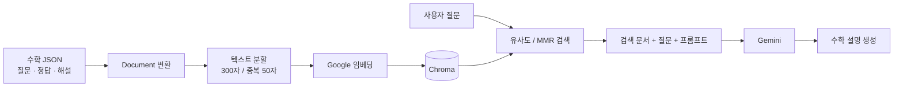

# RAG 기반 AI 수학 학습 튜터 PoC

> 교육 서비스 시장조사와 교사 지원 서비스 기획을 바탕으로, 수학 학습 자료를 검색하고 학습자 눈높이에 맞춰 설명하는 RAG 파이프라인을 구현한 프로젝트입니다.

**프로젝트 기간: 2025.06.09 ~ 2025.06.27**

## 프로젝트 배경

지역에 따른 교육 정보와 학습 지원 접근성의 차이에 주목했습니다. 입시 컨설팅·AI 교육 서비스의 기능과 이용 흐름을 조사하고, 교사가 자료 탐색과 학생 지도에 활용할 수 있는 AI 어시스턴트의 서비스 방향을 기획했습니다.

이 가운데 학습 자료 검색과 설명 생성의 기술적 가능성을 확인하기 위해 **중학교 수학 질문·정답·해설 데이터를 활용한 RAG 튜터 PoC**를 진행했습니다.

## 수행 내용

| 영역 | 내용 |
| --- | --- |
| 시장조사 | 교육 정보 격차 관련 자료, AI 디지털 교과서와 입시 컨설팅 서비스 조사 |
| 서비스 기획 | 교사 친화적인 AI 학습·진로 지도 지원 서비스의 문제와 대상 사용자 정의 |
| 데이터 처리 | 수학 JSON의 질문·정답·해설을 LangChain Document로 변환하고 분할 |
| 검색 구현 | Google 임베딩과 Chroma를 연결하여 유사도 검색 및 MMR 검색 적용 |
| 답변 생성 | Gemini와 검색 문서를 연결하고 중학교 1학년 수준의 설명 프롬프트 적용 |
| 실험 | 동일 질문에 대해 기본 RAG, 학습자 수준을 지정한 RAG, LLM 단독 응답 관찰 |

교사 지원 서비스는 기획 범위이며, 이 저장소의 구현 범위는 **노트북 기반 수학 튜터 PoC**입니다.

## 구현 흐름

## 기술 및 실험 설정

- Python, Google Colab, LangChain, Chroma
- 생성 모델: `gemini-1.5-flash` (원본 실험 설정)
- 임베딩 모델: `models/text-embedding-004` (원본 실험 설정)
- 텍스트 분할: `RecursiveCharacterTextSplitter`, `chunk_size=300`, `chunk_overlap=50`
- MMR 검색: `k=3`, `fetch_k=10`
- 생성 온도: `temperature=0.0`

## 확인한 결과

원본 노트북의 저장된 출력에서 **9,124개 Document 생성**, **9,218개 청크 분할**을 확인할 수 있습니다. 검색부터 답변 생성까지 파이프라인을 연결하고, 학습자 수준을 지정한 프롬프트에 따라 설명 방식이 달라지는 사례를 관찰했습니다.

단일 질문의 예시 비교이며 정량 평가나 사용자 테스트를 수행한 결과는 아닙니다. 검색 문서의 관련성과 생성 답변의 계산 일관성에 한계가 관찰되어, 이를 [실험 기록](docs/experiment-notes.md)에 함께 정리했습니다.

## 자료 안내

- [시장조사 및 서비스 기획](docs/research-and-concept.md)
- [PoC 노트북](notebooks/rag_math_tutor.ipynb)
- [실험 결과 및 한계](docs/experiment-notes.md)
- [데이터 형식과 실행 안내](docs/data-and-execution.md)

공개용 노트북은 원본에서 핵심 셀을 선별한 버전입니다. 키 입력과 경로 설정, 설치 명령, 일부 호출 구문을 정리했으며 대량 출력과 미사용 코드는 제외했습니다. 모델명은 당시 실험 설정을 보존했습니다. 현재 환경에서 API를 재실행한 결과는 아닙니다.
